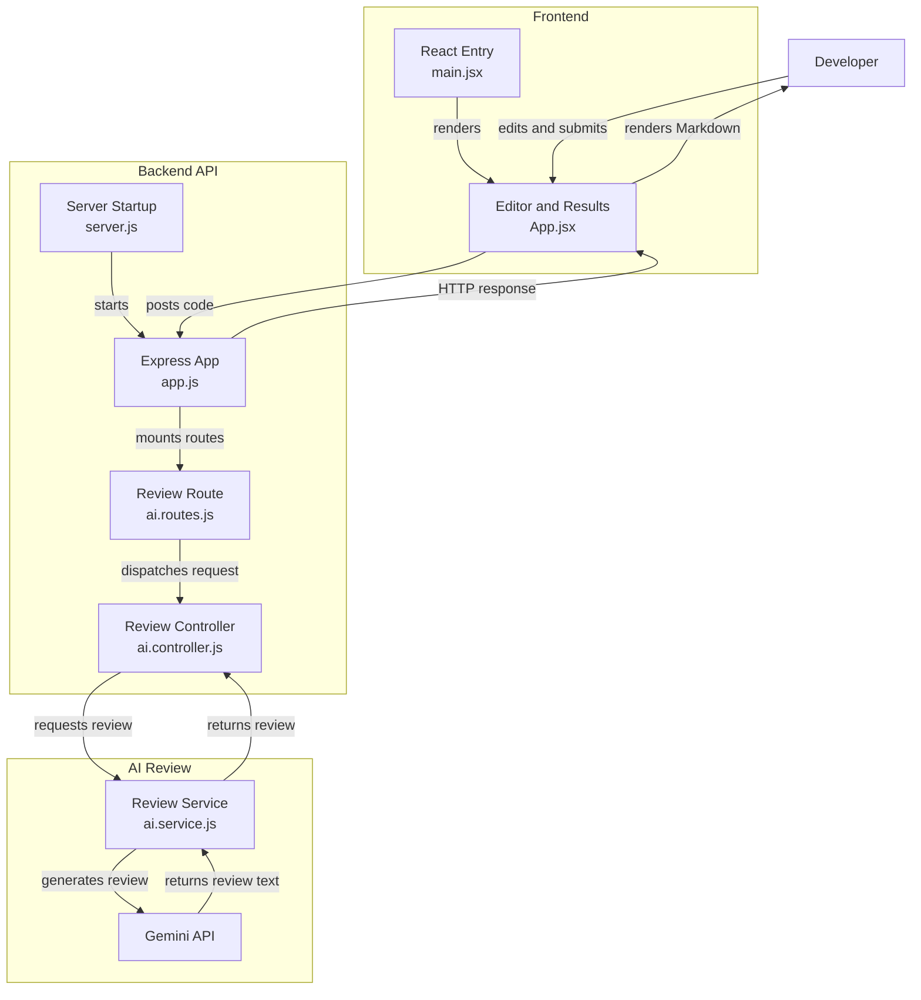

=======

# 🤖 AI Code Review Assistant

An AI-powered Code Review Assistant that analyzes source code and generates intelligent code review feedback using Google's Gemini API.

The application provides an interactive code editor where developers can submit code and receive AI-generated feedback in Markdown format.

## 🚀 Features

- AI-powered code review using Google Gemini API
- Interactive code editor
- Automatic code analysis
- Markdown-formatted review results
- React-based frontend
- Node.js and Express.js backend
- REST API integration
- Modular backend architecture

## 🛠️ Tech Stack

### Frontend
- React.js
- JavaScript
- CSS
- Markdown Rendering

### Backend
- Node.js
- Express.js
- REST API
- JavaScript

### AI Integration
- Google Gemini API

## 🏗️ Project Architecture

The application follows a modular architecture with three main layers:

1. Frontend – Handles code submission and displays review results.
2. Backend API – Handles HTTP requests and routes them to the appropriate controller.
3. AI Review Service – Communicates with Google Gemini API to generate code review feedback.

### Architecture Diagram



## 📂 Project Structure

```text
AI-code-review/
│
├── FrontEnd/
│   ├── src/
│   ├── public/
│   ├── package.json
│   └── main.jsx
│
├── BackEnd/
│   ├── src/
│   │   ├── ai.routes.js
│   │   ├── ai.controller.js
│   │   └── ai.service.js
│   │
│   ├── server.js
│   ├── app.js
│   ├── package.json
│   └── package-lock.json
│
├── .gitignore
└── README.md
```

## ⚙️ Installation and Setup

### 1. Clone the Repository

```bash
git clone https://github.com/jayachandravaddi09-jpg/AI-code-review.git
```

### 2. Navigate to the Project

```bash
cd AI-code-review
```

### 3. Backend Setup

```bash
cd BackEnd
npm install
```

### 4. Configure Environment Variables

Create a `.env` file inside the BackEnd folder.

```env
GEMINI_API_KEY=your_gemini_api_key
```

Use the environment variable name expected by your backend code.

Get your API key from:

https://aistudio.google.com/apikey

### 5. Start Backend Server

```bash
node server.js
```

### 6. Frontend Setup

Open another terminal:

```bash
cd FrontEnd
npm install
```

Start the frontend using the development command defined in FrontEnd/package.json.

## 🔄 Application Workflow

1. Developer opens the AI Code Review application.
2. React renders the code editor and results interface.
3. Developer writes or submits source code.
4. Frontend sends the code to the backend through an HTTP request.
5. Express routes the request to the AI Review Controller.
6. Controller calls the AI Review Service.
7. AI Review Service communicates with Google Gemini API.
8. Gemini generates code review feedback.
9. Backend returns the review response.
10. Frontend displays the review in Markdown format.

## 🔐 Security

- Store API keys in environment variables.
- Never expose API keys in frontend code.
- Do not upload `.env` files to GitHub.
- Keep `node_modules/` out of version control.

## 🎯 Project Objective

The main objective of this project is to simplify the code review process using Generative AI.

It helps developers receive automated code analysis and feedback, making code review more accessible and efficient.

## 👨‍💻 Developer

**Jayachandra Vaddi**

- GitHub: https://github.com/jayachandravaddi09-jpg
- Project: AI Code Review Assistant

---

⭐ If you find this project useful, consider giving it a star!
>>>>>>> 52f1c7bf9cd43af198b226a2912ed0ec79658378
# Jayachandra-protofolio
